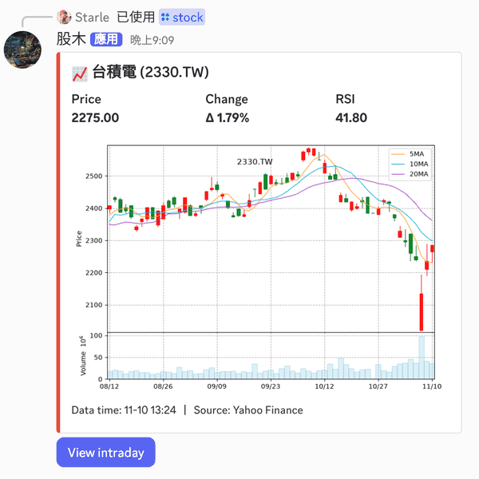
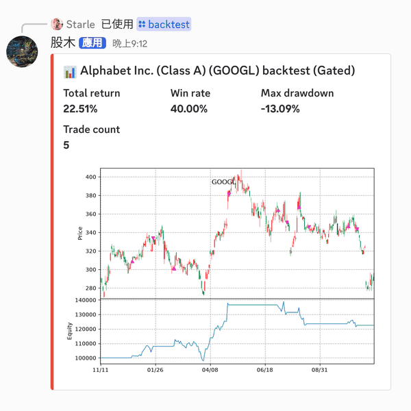

# Stock Bot


量化交易回測框架，用來驗證股票交易策略。支援**做多與做空**、**自訂策略**、**停損**，並計算報酬率、勝率與最大回撤。

核心特性：
- **現金與整股記帳**：只買整股，買不滿一股的零頭留在現金，資金曲線貼近實際
- **策略與引擎解耦**：新增策略不需要修改回測引擎
- **規則依角色組合**：趨勢規則決定能做的方向，進場規則決定時機，出場規則決定何時離場
- **完整交易紀錄**：每筆交易的進出場日期、價格、觸發條件與損益
- **Discord 機器人**：在 Discord 中直接下指令查詢與回測
- **HTTP API**：以 JSON 提供相同的資料，供網頁前端使用

<div>
  
  [](https://discord.com/oauth2/authorize?client_id=1494994206425612399)
  
  
  
</div>

---

## 技術架構

```
stock-bot/
├── src/
│   ├── api/          # HTTP API：路由與回應模型
│   ├── bot/          # Discord 斜線指令與 UI 元件
│   ├── cli/          # 終端互動工具：回測與資料庫管理
│   ├── data/         # 讀取資料（fetcher）與寫入資料（sync）
│   ├── quant/        # 技術指標、規則、策略與回測引擎
│   ├── database/     # 資料庫初始化與 CRUD（SQL 放在 sql/*.sql）
│   ├── models/       # 共用資料類別
│   └── utils/        # 圖表與 HTML 報表
├── scripts/
│   ├── seed_stocks.py           # 匯入台股、美股與全球指數清單
│   ├── historical_backfill.py   # 回補歷史 K 線
│   └── daily_updater.py         # 每日更新行情
├── docs/
│   └── samples/      # HTML 報表範例與產生腳本
├── tests/            # 離線測試（pytest）
└── main.py           # 全域 logging 設定
```

模組職責與指令資料流請見 [docs/ARCHITECTURE.md](./docs/ARCHITECTURE.md)，模組相依關係請見 [docs/UML.md](./docs/UML.md)。

---

## 資料庫結構

```sql
-- 股票基本資料
stocks (
    ticker           TEXT PRIMARY KEY,
    name             TEXT,
    market           TEXT,
    last_backfilled  TEXT   -- 最後一次成功回補的時間，NULL 代表尚未回補
)

-- 歷史日線（OHLCV）
daily_prices (
    id                  INTEGER PRIMARY KEY,
    ticker              TEXT REFERENCES stocks(ticker),
    date                TEXT,
    open_price          REAL,
    high_price          REAL,
    low_price           REAL,
    close_price         REAL,
    adjust_close_price  REAL,  -- 除權息調整後收盤價
    volume              REAL,
    UNIQUE(ticker, date)
)
```

> **除權息調整**：讀取歷史資料時，以 `AdjClose / Close` 的比例換算開高低價，消除配息或分割造成的跳空。
>
> **重抓完整歷史**：Yahoo 每次除息或分割都會改寫**整段歷史**的 `Adj Close`。`daily_updater.py` 偵測到這種改寫，或發現資料中間有缺漏時，會改用 `historical_backfill.py` 重抓該檔股票的完整歷史。

完整 schema 請見 [src/database/sql/schema.sql](./src/database/sql/schema.sql)。

---

## 快速開始

### 環境需求

- Python 3.13+
- [uv](https://docs.astral.sh/uv/) 套件管理器

### 安裝

```bash
uv sync                # 安裝依賴與專案本身
cp .env.example .env   # 建立 .env
```

若出現 `ModuleNotFoundError: src`，重新執行 `uv sync` 即可。機器人需要從專案根目錄啟動，才讀得到 `.env`。

`.env` 欄位：

| 變數 | 說明 |
|------|------|
| `DISCORD_TOKEN` | Discord Bot Token（從 [Discord Developer Portal](https://discord.com/developers/applications) 取得） |
| `GUILD` | （選填）測試伺服器 ID。設定後斜線指令會立即生效，不必等全域同步的約 1 小時 |

### 初始化資料庫

```bash
python scripts/seed_stocks.py          # 寫入股票清單
python scripts/historical_backfill.py  # 回補歷史 K 線（需要一段時間）
```

> 回補可以重複執行：最近補過的股票會略過，下載失敗的會在下次重試。`backfill_history(force=True)` 會全部重補。

### 每日更新（建議用 cron 等工具排程）

```bash
python scripts/daily_updater.py
```

### 執行

```bash
python src/bot/dc_bot.py         # 啟動 Discord 機器人
python src/quant/backtest.py     # 互動式回測
python src/database/database.py  # 互動式資料庫工具

uv run uvicorn src.api.main:app --reload  # 啟動 HTTP API（--reload：存檔後自動重啟）
```

> **HTML 報表**：回測完成後可以匯出 HTML 績效報表；資料庫查詢超過 50 筆時會自動改成匯出報表。檔案存放在 `exports/`。

報表範例（台積電實際資料）：

- [回測績效報表](https://htmlpreview.github.io/?https://raw.githubusercontent.com/JialaChang/Stock-Bot/main/docs/samples/backtest.html)：績效指標與每筆交易明細
- [歷史價格報表](https://htmlpreview.github.io/?https://raw.githubusercontent.com/JialaChang/Stock-Bot/main/docs/samples/prices.html)：OHLCV 明細，收盤價依漲跌上色

> 範例由 `docs/samples/generate.py` 產生，使用的匯出函式和正式流程相同。

### 測試

```bash
uv sync --dev   # 安裝開發依賴（含 pytest）
uv run pytest
```

測試完全離線，不會連線到 yfinance，也不會讀取本機的 `stock_data.db`。

---

## Discord 指令說明

| 指令 | 說明 |
|------|------|
| `/stock <ticker>` | 查詢股票資訊、技術指標與 K 線圖 |
| `/backtest <ticker> <strategy> <period>` | 執行策略回測，回傳績效指標與圖表（K 線、進出場標記、權益曲線） |

> `/stock` 拿不到盤中資料時（例如被限流、網路錯誤，或該標的沒有分時資料），仍會顯示日線圖與指標，只是無法切換到分時圖。
>
> `/backtest` 會額外抓取指標暖身需要的資料，不會佔用你指定的回測區間；資料不足時會回覆原因。

可選策略：

| 策略 | 說明 |
|------|------|
| `RSI` | 單一指標：超賣進場、超買出場 |
| `EMA` | 單一指標：EMA5/20 交叉，交叉時平掉舊倉並反向開倉 |
| `Gated` | 只在長期趨勢允許的方向，依進場訊號開倉 |
| `Vote` | 所有規則等權投票，作為 `Gated` 的對照組 |

代碼輸入範例：

| 輸入 | 自動解析為 | 說明 |
|------|-----------|------|
| `2330` | `2330.TW` | 台積電（台股上市） |
| `5274` | `5274.TWO` | 信驊（台股上櫃） |
| `SPCX` | `SPCX` | SpaceX 美股 |
| `nvda` | `NVDA` | 不分大小寫 |
| `BRK.B` | `BRK-B` | 波克夏 B 股，自動轉成 Yahoo 格式 |
| `^GSPC` | `^GSPC` | S&P 500 指數 |

---

## HTTP API 說明

提供給網頁前端的 JSON 介面，和 Discord 指令使用相同的資料與運算。

| 端點 | 說明 |
|------|------|
| `GET /api/stock/{ticker}` | 股票快照：現價、前收、漲跌幅與 RSI |

> 回應只有原始數值，顯示格式由前端決定。錯誤代碼請見 [docs/ARCHITECTURE.md](./docs/ARCHITECTURE.md)。

---

## 支援市場

### 台灣股票

- **上市（TWSE）**：輸入代碼即可，自動補上 `.TW`
- **上櫃（TPEx）**：輸入代碼即可，自動補上 `.TWO`

### 美國股票

- S&P 500 與 Nasdaq 100 成分股，直接輸入代碼（`AAPL`、`NVDA` 等）
- 有股別的代碼（如 `BRK.B`）以 Yahoo 格式 `BRK-B` 收錄，兩種寫法都查得到

### 全球主要指數

`scripts/seed_stocks.py` 會一併寫入下列指數：

| 區域 | 代碼 | 指數 |
|------|------|------|
| 美國 | `^GSPC` | S&P 500 |
| 美國 | `^DJI` | 道瓊工業 |
| 美國 | `^IXIC` | 那斯達克綜合 |
| 美國 | `^NDX` | 那斯達克 100 |
| 美國 | `^RUT` | 羅素 2000 |
| 美國 | `^SOX` | 費城半導體 |
| 美國 | `^VIX` | 恐慌指數（VIX） |
| 亞太 | `^TWII` | 台灣加權 |
| 亞太 | `^HSI` | 恆生 |
| 亞太 | `000001.SS` | 上證綜合 |
| 亞太 | `399001.SZ` | 深證成指 |
| 亞太 | `^KS11` | 韓國綜合（KOSPI） |
| 亞太 | `^N225` | 日經 225 |
| 歐洲 | `^FTSE` | 富時 100 |
| 歐洲 | `^GDAXI` | 德國 DAX |
| 歐洲 | `^FCHI` | 法國 CAC 40 |
| 歐洲 | `^STOXX50E` | 歐洲 STOXX 50 |
