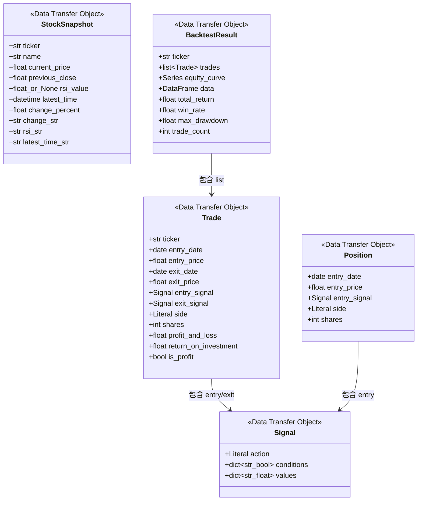
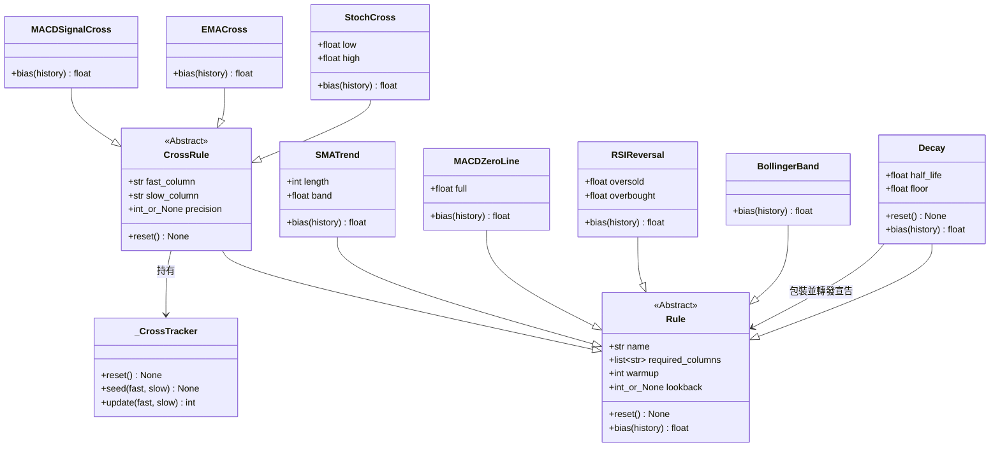
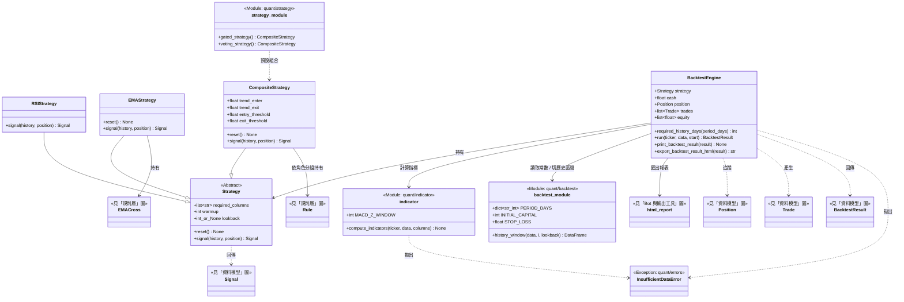
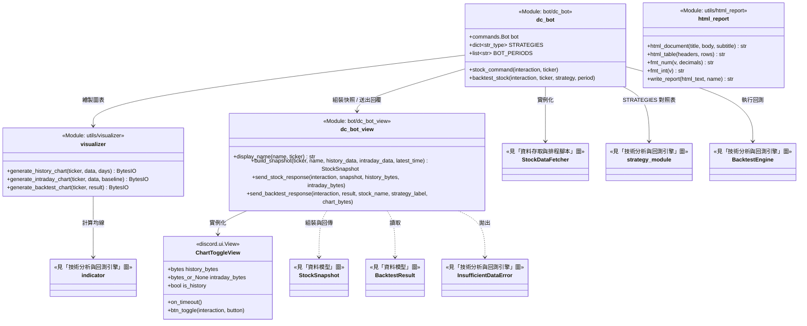
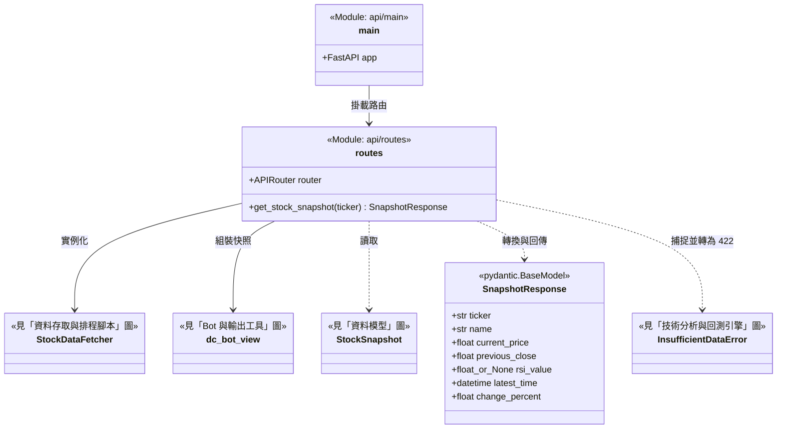
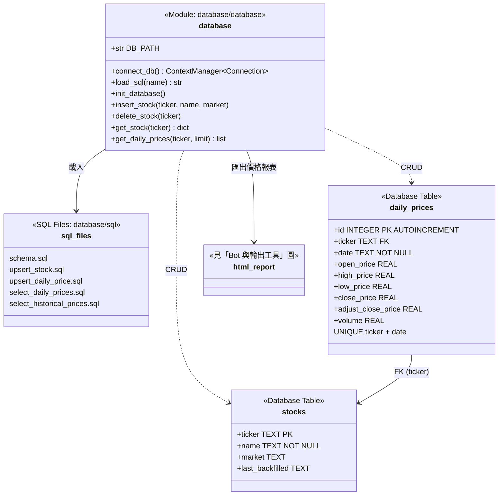
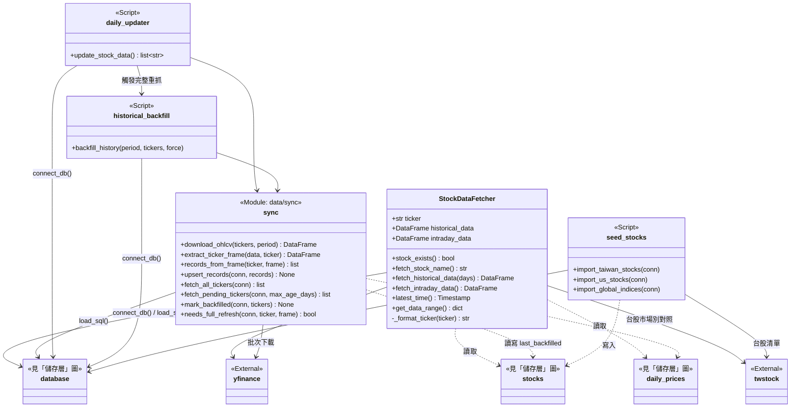

# 模組相依關係

依目錄分成 7 張圖，呈現類別與模組之間的相依方向。行為說明請見 [ARCHITECTURE.md](./ARCHITECTURE.md)。

出現在其他圖的類別標為 `<<見「X」圖>>`，只畫出關聯線。

## 1. 資料模型 (`src/models/`)

## 2. 規則層 (`src/quant/rule.py`)

規則只回報偏向哪一邊，不知道目前的部位；`CompositeStrategy` 依角色把規則分組。

| 分組 | 規則 |
|------|------|
| 趨勢 | `SMATrend`、`MACDZeroLine` |
| 進場 | `RSIReversal`、`StochCross`、`EMACross` |
| 出場 | `BollingerBand`、`MACDSignalCross` |

`Decay` 不屬於任何分組，而是包住事件規則後再放進分組；`gated_strategy()` 用它包裝 `StochCross`、`EMACross` 與 `MACDSignalCross`。

## 3. 技術分析與回測引擎 (`src/quant/`)

引擎不依賴任何資料來源，`run()` 接收呼叫端準備好的 DataFrame。

## 4. Bot 與輸出工具 (`src/bot/`、`src/utils/`)

`html_report` 和 Discord 無關，使用它的是 `BacktestEngine` 與 `database`；放在這張圖只是因為它也在 `src/utils/`。

`visualizer` 在資料副本上用 `indicator` 計算均線，不會改到呼叫端的資料；Embed 需要的 RSI 則由 `build_snapshot` 自己計算。

## 5. HTTP API (`src/api/`)

`routes` 直接使用 `dc_bot_view.build_snapshot`，因此依賴 `bot`；API 和 Bot 共用同一套快照組裝邏輯。

`SnapshotResponse` 只取 `StockSnapshot` 的數值欄位與 `change_percent`，不含 `change_str` 這類格式化字串。

## 6. 儲存層 (`src/database/`)

## 7. 資料存取與排程腳本 (`src/data/`、`scripts/`)

`fetcher` 負責讀取，`sync` 負責寫入行情。兩支回補腳本透過 `sync` 寫入，`seed_stocks` 則直接寫入股票清單。

